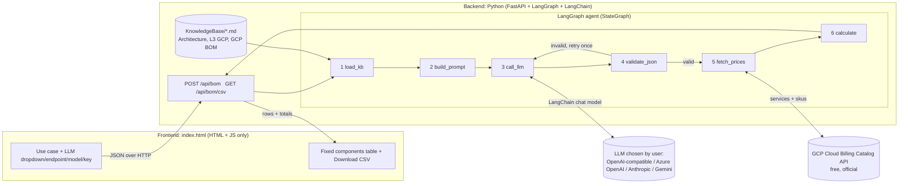

# GCP Fixed-Infra BOM Agent — Build Plan (Phase 1) — v2

Written for: you (project owner), to approve before we build.

**Hard rules (from you):** GCP only. **Backend is Python only** (no Node.js anywhere). The agent is built with **LangGraph + LangChain**. The frontend is **one HTML + JS page**.

## 1. What we build
- `frontend/index.html`: one page (HTML + CSS + vanilla JS, no framework, no npm, no build step).
- `backend/`: a small Python service (FastAPI) that hosts the LangGraph agent.

**Phase 1 input:** the user types only the *use case / functional requirement*, picks an LLM provider (dropdown), endpoint URL, model and API key.
**Phase 1 output:** a *Fixed components* table (same look as your reference tool) with services, SKU/tier, region, base qty per environment, live GCP unit price, monthly cost, total, and **Download CSV**.
**Phase 2 (later):** add the NFR textbox and pass it into the same prompt (availability, latency, peak, DR, etc.). Phase 1 does not block this.

## 2. Architecture



This matches your diagram: the agent (LangGraph/LangChain) reads the knowledge base, calls the LLM with a predefined prompt, gets JSON, calls the GCP cost API, and returns a table with CSV download. The one addition is a validation step with a single retry.

## 3. Technology (Python backend only)

| Part | Technology |
|---|---|
| Agent workflow | **LangGraph** (`StateGraph`, conditional edge for the retry) |
| LLM abstraction | **LangChain** chat models: `ChatOpenAI(base_url=...)` for OpenAI-compatible endpoints, `AzureChatOpenAI`, `ChatAnthropic`, `ChatGoogleGenerativeAI`; chosen at run time from the dropdown |
| Structured output | **Pydantic** models, so the LLM JSON is validated against a schema |
| API server | **FastAPI** + Uvicorn; it also serves `index.html` so there are no CORS problems |
| Price fetching | **httpx** calling the Cloud Billing Catalog API |
| Knowledge base | The three `.md` files in `KnowledgeBase/`, read by the backend at run time (no vector DB; they are small) |
| Frontend | Plain HTML + vanilla JS (`fetch`), no Node, no npm |
| CSV | Generated by the backend (Python `csv` module) |

No Node.js, npm, or JS framework is used anywhere. Run with `pip install -r requirements.txt` then `uvicorn app:app`.

## 4. Agent graph (nodes)
1. **load_kb**: read the KB files and extract the layer → GCP service mapping and the BOM table.
2. **build_prompt**: build the strict prompt: role, KB context, the use case, the allowed GCP service list, the environments, and the exact JSON schema. Temperature 0.
3. **call_llm**: invoke the LangChain model chosen by the user (provider, endpoint, model, key from the request).
4. **validate_json**: parse and validate with Pydantic. Each service must be in the allowed list. If invalid, go back to step 3 once with the error text, then fail with a clear message.
5. **fetch_prices**: call `services.list`, match the service by display name, then `skus.list`, and filter by region and by keywords from `sku_tier`. Take the on-demand unit price.
6. **calculate**: `monthly = qty(env) × hours/month (730) × unit price/hr` per environment, then the total.

## 5. LLM prompt contract (must be strict)
The system prompt says: use **only** services from the allowed list; fixed, always-on infrastructure only (no token or usage-based items); the default environments; return JSON only.

```json
{ "assumptions": ["..."],
  "components": [
    { "layer": "Knowledge & Memory",
      "service": "Memorystore for Redis",
      "sku_tier": "Standard, 5 GB",
      "region": "asia-south1",
      "unit": "GB-hour",
      "qty": { "DEV": 1, "SIT": 1, "UAT": 1, "PROD": 3 },
      "reason": "short-term session memory" } ] }
```

## 6. Free cost fetching
| Need | Free option | Notes |
|---|---|---|
| Live GCP prices for all services | **Cloud Billing Catalog API** (`cloudbilling.googleapis.com/v1/services` and `/services/{id}/skus`) | Free and official. Needs a free API key. It is held on the backend (env var `GCP_PRICING_API_KEY`), so users do not paste it into the page. |
| Fallback if the key is missing or the API fails | Small static price table in Python, labelled `static` | The row's Source column shows `static`, so nothing is silently wrong. |

If several SKUs match, the backend picks the on-demand one and shows the SKU description in the table. Users can edit the price manually and totals recalculate.

## 7. UI (single page)
Top bar: Region, Hours/month (730), LLM provider dropdown, endpoint URL, model, API key. Then the use-case textbox, **Design & build BOM**, and the Fixed components table (Component, SKU/tier, Region, DEV/SIT/UAT/PROD qty, Price/hr, Source, Monthly), with a Fixed subtotal, **Download CSV** and Reset. Cells are editable and totals recalculate.

## 8. Security notes
- The user's LLM key is sent per request over HTTPS, held in memory only, never logged or saved.
- The pricing key lives only in a backend environment variable.

## 9. Project layout
```
RE/
  KnowledgeBase/   (3 .md files, already done)
  backend/  app.py  graph.py  prompts.py  pricing.py  schemas.py  requirements.txt
  frontend/ index.html
```

## 10. Build order
1. Backend skeleton (FastAPI) + `index.html` + table + CSV with static data.
2. LangGraph agent: KB loader, prompt, LLM provider switch, Pydantic validation and retry.
3. Billing Catalog price matcher + calculation.
4. Test with 3 sample use cases; fix SKU-matching gaps.
5. Phase 2: NFR box and prompt extension.

## 11. Open points for you to confirm
1. **Environments:** you wrote "4: DEV, SIT, Prod", which names only three. I assumed **DEV, SIT, UAT, PROD**.
2. **Default region:** `asia-south1` (Mumbai). Confirm or give another.
3. **Scope of "fixed":** only always-on, instance-priced items (GKE, Cloud Run min instances, Cloud SQL/AlloyDB, Memorystore, Apigee, Vector Search endpoint, Composer, etc.). Token and usage items (Gemini tokens, STT, Pub/Sub) are excluded in Phase 1.
4. **Pricing key:** a free GCP API key with the Cloud Billing API enabled is needed for live prices; without it the table falls back to static prices.
5. **Python version:** I'll target Python 3.11+. Tell me if you use a different one.

