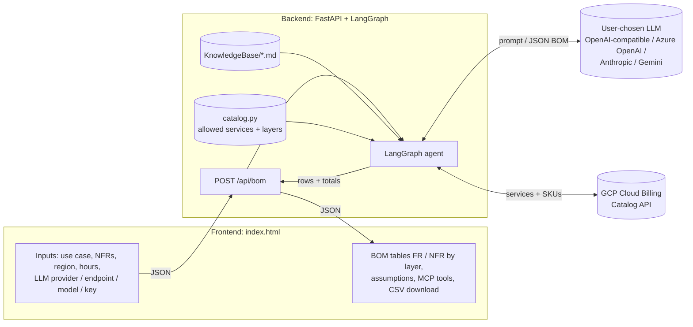
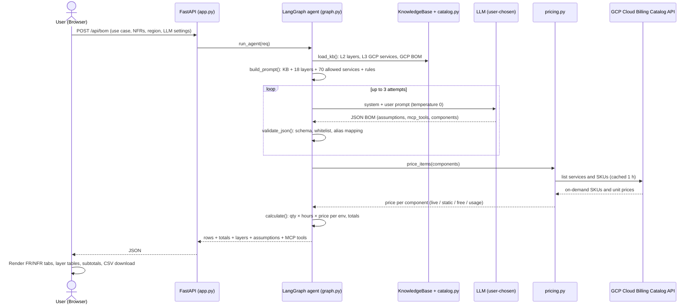

# GCP Enterprise BOM Agent

An AI agent that turns a plain-English **use case** and its **non-functional requirements (NFRs)** into an enterprise-grade **Google Cloud Bill of Materials (BOM)**. The BOM lists every GCP component, its count per environment (DEV / SIT / UAT / PROD), its **live GCP price**, and the monthly cost. Every component is mapped to the layers of the **IBM Multi-Agent Systems Reference Architecture**.

Stack: Python backend (FastAPI + LangGraph + LangChain) and one HTML/JS page. GCP only. No Node.js, npm or build step.

---

## 1. Project purpose

### The problem
When a solution architect sizes a new agentic AI solution on GCP, they have to:
1. Decide which GCP services each architecture layer needs (channels, orchestration, tools/MCP, memory, models, data, deployment, security, governance, operations).
2. Decide how many of each are needed in every environment.
3. Look up the price of each service in the right region and work out the monthly cost.

This is slow and manual, and the results vary from one architect to the next.

### The solution
The agent automates all three steps:

| Step | Who does it | How |
|---|---|---|
| Architecture design | **LLM**, guided by a knowledge base | The IBM reference architecture (L2 layers, L3 GCP components, GCP BOM) goes into a strict prompt. The LLM may only choose from an allowed list of ~70 GCP services. |
| Validation | **LangGraph agent** | The JSON is checked against a Pydantic schema and the service whitelist. If it fails, the agent retries and tells the LLM what was wrong. |
| Pricing | **Cloud Billing Catalog API** (official, free) | Each service is matched to a real on-demand SKU for the chosen region. |
| Cost calculation | **Deterministic Python** | `qty × hours × unit price` per environment, with subtotals and totals. |

**Key design idea:** the LLM only makes *architecture decisions* (which services, how many, what size). It never produces prices or arithmetic. Prices come from Google's catalog and costs come from code, so the numbers can be traced and repeated.

---

## 2. Repository structure

```
.
├── backend/
│   ├── app.py              FastAPI server: serves the page + POST /api/bom
│   ├── graph.py            LangGraph agent (6 nodes + retry loop)
│   ├── prompts.py          Knowledge-base loader + strict system/user prompt
│   ├── catalog.py          Allowed GCP services, pricing rules, architecture layers
│   ├── pricing.py          Cloud Billing Catalog API client + SKU matcher + static fallback
│   ├── schemas.py          Pydantic models (request + LLM output schema)
│   └── requirements.txt    Python dependencies
├── frontend/
│   └── index.html          Single-page UI (HTML + CSS + vanilla JS)
├── KnowledgeBase/
│   ├── 01_Architecture_Overview.md        L2 layer stack of the IBM reference architecture
│   ├── 02_L3_GCP_Component_Overview.md    L3 components per layer, GCP view + Security & Governance
│   ├── 03_GCP_BOM.md                      GCP BOM: logical -> physical service mapping
│   └── Screenshot *.png                   Source screenshots the KB was written from
├── Images/                 Screenshots of the IBM reference-architecture site, the
│                           reference BOM tool, and the hand-drawn agent flow design
├── Design_Plan_GCP_BOM_Agent.md   Original build plan (Phase 1 / Phase 2)
└── README.md
```

---

## 3. High-level architecture



---

## 4. Code flow (end to end)

### 4.1 Request lifecycle

1. **The user fills in the form** in `index.html`: region (dropdown, default `asia-south1`), use case, NFRs, LLM provider, endpoint, model and API key. Then they click **Design & build BOM**.
2. **The browser** checks that the use case is at least 10 characters and that a model and API key are present. It then sends a `POST /api/bom` with a JSON body.
3. **`app.py`** checks the body against `BomRequest` (`schemas.py`) and calls `run_agent(req)`.
4. **`graph.py`** runs the compiled LangGraph `StateGraph`:

```
START → load_kb → build_prompt → call_llm → validate_json ─┬─ valid ───────────→ fetch_prices → calculate → END
                       ▲                                    ├─ invalid, attempts < 3 ─┘ (back to build_prompt with the error)
                       └────────────────────────────────────┘
                                                            └─ invalid, 3 attempts → END (error)
```

(Run `python graph.py` in `backend/` to print the real graph as ASCII.)

5. **The response JSON** goes back to the browser, which renders the tables.

### 4.2 The six agent nodes

| # | Node | What it does | Produces (state keys) |
|---|---|---|---|
| 1 | `load_kb` | Calls `prompts.load_kb()`, which takes the key sections out of the 3 KB markdown files: the L2 layer stack, the L3 layer→service index, the Security & Governance components, and the GCP BOM table. Raises an error if the KB is missing. | `kb`, `attempts=0`, `error=None` |
| 2 | `build_prompt` | Calls `prompts.build_prompt()` to build the **system prompt**: architect role, KB context, the 18 layer ids, the allowed service list, 12 strict rules, and a JSON example. It also builds the **user prompt**: the use case and NFRs. On a retry, it adds *"Your previous answer was rejected: <error>"*. | `system`, `user` |
| 3 | `call_llm` | Builds the LangChain chat model for the chosen provider (`ChatOpenAI`, `AzureChatOpenAI`, `ChatAnthropic`, `ChatGoogleGenerativeAI`) with temperature 0. If the model rejects a temperature setting (some reasoning models do), it retries without one. It also records the stop reason so a cut-off answer can be spotted. | `raw`, `stop`, `attempts+1` |
| 4 | `validate_json` | Removes markdown fences and pulls out the `{...}` object (it also repairs trailing commas). It then validates the JSON against `LlmBom`, rejects any service not in the catalog, and maps aliases to the canonical names (e.g. `"gke"` → `Google Kubernetes Engine (cluster)`). If the answer was cut off by the token limit, it tells the LLM to shorten it. | `bom` **or** `error` + `failed` |
| 5 | `fetch_prices` | For each component it calls `pricing.price_items()` to get a live or static price. It also attaches the group, layer (checked with `catalog.normalize_layer`), section and count unit. | `rows` |
| 6 | `calculate` | Works out the monthly cost per environment and per row, then the totals by group (fixed/nfr), by environment, and overall. | `totals` |

The conditional edge `after_validate` routes the graph to `fetch_prices` (valid), back to `build_prompt` (invalid, retries left), or to `END` (invalid after `MAX_ATTEMPTS = 3`).

### 4.3 Pricing logic (`pricing.py`)

For each component, `price_items()` decides where the price comes from:

```
service marked free?            → "Free" ($0)
no GCP_PRICING_API_KEY set?     → static approximate price  (source: "static (approx; set GCP_PRICING_API_KEY ...)")
catalog API error?              → static approximate price  (source: "static (approx; catalog error: ...)")
live SKU matched?               → live price                (source: "gcp-catalog" or "gcp-catalog (low match - verify)")
no SKU matched?                 → static approximate price  (source: "static (approx; no catalog match)")
public GCP list-price page     → web list price            (source: "web list price (<page>)"; used only when no live SKU matches)
no list price exists at all     → basis text only           (safety path; no shipped service uses it)
```

The catalogue is use-case independent: every GCP product the knowledge base names (Looker, Model Garden, AutoML, BigQuery ML, Training Job, Gen AI Evaluation, Code Execution Sandbox, Distributed Cloud, Gemini Code Assist ...) is offered to the LLM. Per-model / per-edition services (Model Garden, AutoML, Looker, Distributed Cloud) need `sku_tier` to name the model or edition; a name with no SKU leaves the cells empty instead of borrowing another model's price. Audited live in five regions (asia-south1, us-central1, europe-west2, australia-southeast1, me-central1): 65 services resolve to a live SKU, 7 to a labelled web list price, 9 are free.

**How live matching works:**
1. `GET /v1/services` lists all GCP billing services. The result is cached for 1 hour.
2. The agent picks the service whose display name matches the catalog candidates (exact match first, then substring).
3. `GET /v1/{service}/skus` lists that service's SKUs in USD, cached for 1 hour. Distinct services are fetched in parallel with 8 threads.
4. `_best()` filters the SKUs:
   - **On-demand** only.
   - Region must match or be `global`.
   - Excludes commit, spot, preemptible, licence, reserved, sole-tenancy, Windows, GPU and TPU SKUs.
   - Required tokens (e.g. Cloud NAT needs `nat`) must be present.

   It then scores each SKU by preferred keywords plus words from the LLM's `sku_tier`, and adds a bonus for a region-specific SKU.
5. Prices in any time unit (`s`, `min`, `h`, `d`, `mo`) are converted to an hourly rate.

**Pricing modes** (set per service in `catalog.py`):

| Mode | Meaning | Monthly cost formula | Example services |
|---|---|---|---|
| `hour` | Price per unit-hour | `qty × 730 h × $/hr` | GKE cluster fee, Spanner node, Apigee, Load Balancing, Cloud NAT |
| `shape` | Priced by vCPU + RAM | `qty × 730 h × (vCPU × $cpu/hr + GiB × $ram/hr)` | Compute Engine, Cloud Run, MCP Server, Cloud SQL, AlloyDB |
| `month` | Flat monthly price | `qty × $/month` | Cloud Armor policy, KMS key, Secret Manager, Cloud DNS zone |
| `free` | No charge | `0` | IAM, VPC-SC, Model Registry, Firebase Cloud Messaging |
| `usage` | Priced per unit of usage (tokens, GB, queries) | `LLM-estimated monthly volume × $/usage unit` (0 where qty is 0) | Gemini tokens, BigQuery, Pub/Sub, Cloud Storage, Logging |

For `usage` services the LLM returns `usage` (monthly volume per environment) in the unit shown in the prompt, e.g. "1M input tokens". `USAGE_UNITS` in `catalog.py` maps each unit to its Cloud Billing unit and scale, and a live SKU is only accepted if its `usageUnit` or `baseUnit` matches, so the price and the volume are always in the same unit. Services with no list price (Looker, CCAI Platform, Model Garden, ...) have empty price, formula and cost cells and are left out of the totals.

For Cloud SQL and AlloyDB, the matcher prefers **regional** SKUs when the tier says "HA" and **zonal** SKUs otherwise. Missing vCPU/RAM defaults to 1 vCPU and 2 GiB (Cloud Run) or 4 GiB per vCPU.

---

## 5. What each file does and produces

| File | Responsibility | Produces / exposes |
|---|---|---|
| `backend/app.py` | FastAPI entry point. Serves the page and the API, and turns errors into HTTP responses. It never echoes the request back, so the API key cannot leak in an error. | `GET /` → `index.html`; `POST /api/bom` → BOM JSON; `422` if the LLM never returns a valid BOM; `502` on provider or network errors |
| `backend/graph.py` | The LangGraph agent: state definition, LLM factory, JSON extraction, 6 nodes, conditional retry edge. | `GRAPH` (compiled graph), `run_agent(req)` → final response dict; `python graph.py` prints the graph |
| `backend/prompts.py` | Loads the knowledge base and builds the strict prompt. | `load_kb()` → KB context text; `build_prompt()` → `(system, user)` strings |
| `backend/catalog.py` | The single source of truth for **which services exist and how they are priced**, plus the **18 reference-architecture layers** (9 functional + 9 non-functional). | `CATALOG` (70 services: 45 fixed + 25 nfr, 9 free); `LAYERS`, `LAYER_BY_ID`; `canonical_service()` (alias lookup); `normalize_layer()` (fixes invalid layer choices) |
| `backend/pricing.py` | Cloud Billing Catalog client, SKU matcher, unit conversion, in-memory cache, static fallback. | `price_items(items)` → one price dict per component: `mode`, `price_text`, `source`, `sku_desc`, `unit_hr` / `unit_month` / `usage_price` |
| `backend/schemas.py` | Pydantic contracts. | `BomRequest` (API input); `LlmComponent`, `LlmBom` (LLM output schema, checks qty ≥ 0 and fills in all 4 environments); `ENVS = [DEV, SIT, UAT, PROD]` |
| `backend/requirements.txt` | Dependencies. | fastapi, uvicorn, httpx, pydantic 2, langgraph, langchain-core / -openai / -anthropic / -google-genai, grandalf (for the ASCII graph) |
| `frontend/index.html` | The whole UI: input form, provider dropdown, show/hide key, results rendering, layer navigation, totals-only toggle, CSV export. | The rendered BOM page and the `gcp_enterprise_bom.csv` download |
| `KnowledgeBase/01_Architecture_Overview.md` | L2 view: 9 layers in 6 groups plus Security & Governance. | Layer-stack context for the prompt |
| `KnowledgeBase/02_L3_GCP_Component_Overview.md` | L3 GCP components per layer, interaction sequences, Security & Governance groups. | Layer→service index and NFR component context for the prompt |
| `KnowledgeBase/03_GCP_BOM.md` | Recommended GCP services per layer and the logical→physical mapping. | BOM reference table for the prompt |
| `Design_Plan_GCP_BOM_Agent.md` | The original approved build plan. | Requirements and design rationale |
| `Images/`, `KnowledgeBase/*.png` | Source screenshots (IBM reference-architecture site, reference BOM tool, hand-drawn agent flow). | Evidence used to write the KB |

### The 18 architecture layers (from `catalog.py`)

| Kind | Section | Layers |
|---|---|---|
| **Functional (FR)** | USERS | User |
| | ENGAGEMENT | Channels · Business Process – Workflows & Applications |
| | MULTI AGENT SOLUTION | Agentic Orchestration · Tool & Integration · Knowledge & Memory · AI Model |
| | DATA | Enterprise Data & Systems |
| | INFRASTRUCTURE | Deployment Layer |
| **Non-functional (NFR)** | SECURITY | Identity & Delegation · Adversarial AI & Model Defense · Tool & Runtime Sandboxing · Data, Secrets & Privacy · Perimeter & Threat Posture |
| | GOVERNANCE | Access & Model Registry · Responsible AI & Quality · FinOps & Data Lifecycle |
| | OPERATIONS | Operations, Observability & Performance |

---

## 6. Data contracts

### 6.1 Request (`POST /api/bom`)
```json
{
  "use_case": "Customer support agent that answers order-status questions ...",
  "nfr": "99.9% availability, response < 2 s, 1 lakh users/day, PII stays in India ...",
  "provider": "openai_compatible | azure_openai | anthropic | gemini",
  "endpoint": "https://api.openai.com/v1",
  "model": "gpt-4o",
  "api_key": "sk-...",
  "region": "asia-south1"
}
```

### 6.2 What the LLM must return (checked by `LlmBom`)
```json
{
  "assumptions": ["1 lakh users/day with 3x peak", "PROD runs HA across zones"],
  "mcp_tools": ["order_lookup", "customer_search"],
  "components": [
    {"group": "fixed", "layer": "data", "service": "Cloud SQL",
     "sku_tier": "PostgreSQL, HA", "vcpu": 4, "ram_gb": 16,
     "qty": {"DEV": 1, "SIT": 1, "UAT": 1, "PROD": 1}},
    {"group": "nfr", "layer": "sec_perimeter", "service": "Cloud Armor",
     "sku_tier": "WAF policy", "vcpu": 0, "ram_gb": 0,
     "qty": {"DEV": 1, "SIT": 1, "UAT": 1, "PROD": 1}}
  ]
}
```

### 6.3 API response (what the frontend renders)
```json
{
  "assumptions": ["..."],
  "mcp_tools": ["order_lookup", "..."],
  "layers": [{"id": "data", "name": "Enterprise Data & Systems", "section": "DATA", "kind": "fr", "purpose": "..."}],
  "rows": [{
    "group": "fixed", "layer_id": "data", "layer": "Enterprise Data & Systems", "section": "DATA",
    "service": "Cloud SQL", "sku_tier": "PostgreSQL, HA", "region": "asia-south1", "unit": "instance",
    "vcpu": 4, "ram_gb": 16, "qty": {"DEV": 1, "SIT": 1, "UAT": 1, "PROD": 1},
    "mode": "shape", "price_text": "$0.2772 / instance-hr (4 vCPU, 16 GiB)",
    "source": "static (approx; set GCP_PRICING_API_KEY for live prices)", "sku_desc": "",
    "monthly": {"DEV": 202.36, "SIT": 202.36, "UAT": 202.36, "PROD": 202.36},
    "monthly_total": 809.44
  }],
  "totals": {
    "fixed": {"DEV": 0, "SIT": 0, "UAT": 0, "PROD": 0, "ALL": 0},
    "nfr":   {"DEV": 0, "SIT": 0, "UAT": 0, "PROD": 0, "ALL": 0},
    "ALL": 0
  },
  "envs": ["DEV", "SIT", "UAT", "PROD"],
  "hours_per_month": 730
}
```
*(The Cloud SQL row is a worked example using the static fallback: 4 × $0.0413 + 16 × $0.007 = $0.2772/hr, × 730 h = $202.36 per environment, 809.44 across 4 environments.)*

---

## 7. Final outcomes and what the user sees

After a successful run, the status line shows **"Done: N components."** and the page shows:

### 7.1 Assumptions card
A bullet list of the sizing and design assumptions the LLM made, e.g. traffic, peak factor, HA choices and model choice.

### 7.2 Bill of materials card (main output)
- **Two tabs:** **Functional (FR)** and **Non-functional (NFR)**, each with a component count.
- **Left sidebar:** the reference-architecture layers grouped by section (USERS, ENGAGEMENT, MULTI AGENT SOLUTION, DATA, INFRASTRUCTURE for FR; SECURITY, GOVERNANCE, OPERATIONS for NFR), with a component count per layer. Empty layers are greyed out. There is also an **All layers** entry.
- **Layer header:** section badge, layer name and purpose.
- **Per-layer table:**

  | Component | SKU / tier | DEV | SIT | UAT | PROD | Price (live) | Monthly ($) |
  |---|---|---|---|---|---|---|---|
  | **Cloud SQL**<br/>count in instance | PostgreSQL, HA<br/>4 vCPU · 16 GiB | 1 | 1 | 1 | 1 | $0.2772 / instance-hr<br/>*source* | 809.44 |

  - The **source** line is **green** for live catalog or free prices and **amber** for static estimates. Hover over it to see the matched SKU description.
  - Usage-priced services show the LLM's estimated monthly volume under each environment's count, and the monthly cost = volume × unit price (e.g. 200 × "$1.25 per 1M input tokens" = 250.00). The basis of each estimate is listed in the assumptions.
  - The catalogue contains only GCP products that GCP prices. Any row without a price (safety path) leaves the price, formula and cost cells **empty**.
  - The footer shows the **layer subtotal per environment** and the **monthly total**. It notes "excl. services without a list price" only when such rows are present.
- **All layers view:** every non-empty layer one after another, then a **Functional total** or **Non-functional total** table.
- **"See total instances only" toggle:** switches to a compact view with columns *Component · Total instances · Price per instance · Monthly ($) = instances × price*.

### 7.2b GCP costing method (modelled on a real cloud estimate)
The agent follows the same method as a finance-grade cloud estimate: fixed capacity per environment, consumption volumes per environment, and a separate one-time build cost.
- **Input and output tokens are separate rows**: `Vertex AI Gemini (LLM)` (input) and `Vertex AI Gemini Output (LLM)` (output), plus `Vertex AI Embeddings` for retrieval. Each is priced from its own live SKU (Flash vs Flash-Lite and Pro are matched from `sku_tier`).
- **Database storage is its own row**: `Cloud SQL Storage` (GB stored), using the Regional SKU when the database sku_tier says HA.
- **API traffic**: `API Gateway` (per 1M calls) for light traffic to order / CRM / tool APIs; `Apigee` only for an enterprise API programme (the KB maps "API Gateway / Tool Registry" to Apigee / Apigee API Hub). `Application Integration` prices workflow connections.
- **Security Command Center**: one PROD subscription (its minimum is organisation-wide), priced from the public page when the catalogue has no match.
- **One-time build volume** (`build_usage`): initial document OCR or embedding loads are priced once, shown in a "One-time build ($)" column, and kept out of the monthly total (`totals.ONE_TIME`).
- **Exclusions card**: what the estimate leaves out (egress, support plan, discounts, people effort).

### 7.3 MCP tools card
Chips listing the MCP tool endpoints the agents need, e.g. `order_lookup`, `customer_search`.

### 7.4 CSV export (`gcp_enterprise_bom.csv`)
Columns: `Type, Section, Layer, Service, SKU/Tier, vCPU, RAM GiB, Qty DEV, Qty SIT, Qty UAT, Qty PROD, Usage unit / month, Usage DEV, Usage SIT, Usage UAT, Usage PROD, One-time build volume, Price (live), Price source, Formula, Monthly total (USD), One-time build (USD)`. After the rows come a **TOTAL** row, the exclusions, the MCP tools, and the assumptions. The file has a UTF-8 BOM so it opens correctly in Excel.

### 7.5 Error outputs
- Missing or short use case, or a missing model or key → red message in the page before any call is made.
- LLM never returns a valid BOM after 3 attempts → HTTP 422 with the last validation error.
- Provider or network failure → HTTP 502 with the error type and a short message. The request, including the key, is never echoed back.

---

## 8. Run

```
cd backend
pip install -r requirements.txt
$env:GCP_PRICING_API_KEY="your_key"      # PowerShell (optional, for live prices)
python -m uvicorn app:app --port 8000
```
Open http://127.0.0.1:8000.

Print the agent graph: `python graph.py`

### Live GCP prices (free)
1. Google Cloud Console → create or pick a project (the Catalog API does not need a billing account).
2. APIs & Services → Library → enable **Cloud Billing API**.
3. APIs & Services → Credentials → Create credentials → **API key**. Restrict it to the Cloud Billing API.
4. Set it as `GCP_PRICING_API_KEY` before starting the server.

Prices are fetched on each request, and the catalog is cached in memory for 1 hour. Without the key, the table uses approximate static prices and the source line says "static".

### Supported LLM providers
| Provider | Endpoint field | Model field example |
|---|---|---|
| OpenAI-compatible | Base URL (e.g. `https://api.openai.com/v1`, or any compatible gateway) | `gpt-4o` |
| Azure OpenAI | Azure resource endpoint (required) | deployment name |
| Anthropic | Optional custom base URL | Claude model id |
| Google Gemini | not used | `gemini-2.5-pro` |

---

## 9. Security and reliability features

- **API key handling:** the user's LLM key is sent with each request, used in memory, and never stored or logged. Error messages never include request details. The pricing key lives only in a backend environment variable.
- **Hallucination guard:** a service whitelist, alias-to-canonical mapping, schema validation and layer normalisation together mean the LLM cannot invent services or layers.
- **Self-correcting retry:** validation errors are sent back to the LLM, up to 3 attempts in total. Answers cut off by the token limit get a "make it shorter" hint.
- **Transparent pricing:** every price shows its source (live, low-match, static or free), usage volumes are LLM estimates listed in the assumptions, and services without a list price are clearly kept out of the totals.
- **Provider quirks handled:** if a model rejects the temperature setting, the call is retried without it. Trailing commas in JSON are repaired.

---

## 10. What we have done so far (progress against the design plan)

| Planned item (`Design_Plan_GCP_BOM_Agent.md`) | Status |
|---|---|
| Knowledge base built from the IBM Multi-Agent Systems Reference Architecture (L2, L3 GCP, GCP BOM) | ✅ Done: 3 markdown files written from the screenshots |
| Python-only backend (FastAPI) with one HTML/JS page | ✅ Done |
| LangGraph agent: load_kb → build_prompt → call_llm → validate_json → fetch_prices → calculate | ✅ Done |
| LLM provider choice at run time (OpenAI-compatible, Azure OpenAI, Anthropic, Gemini) | ✅ Done |
| Strict prompt + Pydantic validation + retry | ✅ Done, and extended from 1 retry to up to 3 attempts with error feedback |
| Live prices from the Cloud Billing Catalog API, with labelled static fallback | ✅ Done, with SKU scoring, region filter, 1-hour cache and parallel fetching |
| Per-environment quantities (DEV, SIT, UAT, PROD) and monthly cost | ✅ Done |
| Table output + CSV download | ✅ Done (the CSV is generated in the browser) |
| **Phase 2: NFR input** | ✅ Done early: NFR textbox, separate NFR group and NFR layers (Security, Governance, Operations) |
| Extras beyond the plan | ✅ Mapping to the 18 reference-architecture layers, layer sidebar navigation, FR/NFR tabs, "total instances only" view, MCP tool list, assumptions panel, 70-service catalog including usage-based and free services |
| Editable cells with live recalculation (from the plan) | ⏳ Not built yet. The tables are read-only. |
| Separate variable-cost table with volumes (tokens, calls) | ⏳ Not built yet. Usage-based services show their unit price but are not totalled. |

---

## 11. Overview of the entire workflow



**In one paragraph:** the user describes *what* they want to build and *how well* it must run. The agent grounds an LLM in the IBM Multi-Agent reference architecture and forces it to choose only from a curated list of GCP services. It validates the answer and retries when needed. Each chosen service is then matched to a real, region-specific, on-demand SKU from Google's official billing catalog, and code computes the monthly cost per environment. The result is a layer-by-layer, environment-by-environment, priced bill of materials for both functional and non-functional (security, governance, operations) components. It can be reviewed in the browser or exported to CSV.

> **Note:** the BOM is an LLM proposal. Review it before you use it. Usage-based services (tokens, storage, queries) need volume estimates and are not included in the totals.
